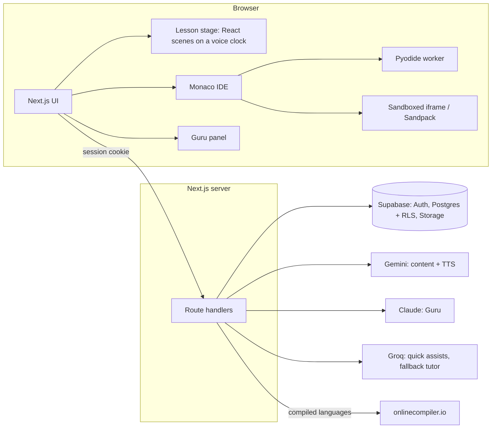

# LearnMate

Turn study material into **animated, voice-narrated lessons**, **hands-on coding practice** and a **personal AI tutor**.

Upload a PDF chapter (or paste notes). LearnMate finds the topics, finds which ones you don't understand yet, and builds a lesson, a live coding workspace and a revision plan around you. Built for the Equinox hackathon, problem 1: *Turn Study Materials into Personalised Learning*.


## What it does

1. **Ingest** a PDF (up to 20 pages / 10 MB) or pasted text. Pages are extracted one by one and stored. Gemini returns a topic map (5-8 topics with page numbers) and runnable worksheet exercises with tests.
2. **Animated lesson** per topic, **directed as an expert motion animator**. The model chooses and orders scenes from a fixed library of hand-built React scenes (title, key terms, bento overview, analogy, code, variable trace, flowchart, list blocks, repeat mosaic, checkpoint) and writes the narration they are timed to: every on-screen label is spoken in the order it appears, and chosen emphasis words trigger camera punches and caption highlights. Scenes are plain React components animated on a clock driven by a **recorded narration**, with each beat landing on the word actually being spoken. Lesson scripts and narration are written by **Claude** under a master-teacher prompt (`lib/ai/prompts/master-teacher.ts`) plus the motion-director prompt; if both Claude models fail or return a thin lesson (fewer than 6 valid scenes, or more than 1 dropped), **Groq** (`GROQ_LESSON_MODEL`) is the fallback. Gemini is never used for lessons. Every scene shows and links its **source page**. Variable traces come from **really executing the code** (Pyodide), never from the model.
2a. **Any subject, not just Python.** On upload the material is classified in the same call that finds the topics. **Coding material** (Python, JavaScript, HTML/CSS, React, C, C++, Java, Go, Rust) gets a course in that language: the exercises, the editor, the lesson's code scenes and Guru's fixes are all in it, and the scratch pad opens in it. **Anything else** (biology, history, maths, law...) gets no editor: it gets interactive practice questions instead (multiple choice with a verified source quote, fill-in-the-blank, and short answers graded by AI in about a second), and lessons that use only concept scenes (including new *Steps* and *Compare* scenes) and never show code. Practice answers feed mastery, the plan and the checklist exactly like exercises do.
2ab. **Profile, settings and course options.** An avatar menu opens a **profile** (stats, nine milestone badges computed from real activity, and the editable "about you" that personalises every AI) and **settings** (theme, language, lesson voice, change password, download all your data as JSON, and delete your account, which needs your password and a typed confirmation). Each course has rename and delete.
2aa. **Sign-up and welcome.** Sign-up asks for name, email and password, then (optionally) goal, level, what they want to study, minutes a day and language; the database trigger copies these onto the profile, and every AI (Guru, lessons, notes, mind maps) is told the learner's level and goal. First sign-in plays a short, skippable **animated welcome** built from the same motion engine as the lessons, personalised with their name and interests.
2b. **Study tools per course** (tabs inside each course): **quizzes** with accuracy by topic and a question-by-question review of every attempt; **revision notes** (TL;DR, key points with page links, terms, common mistakes, worked example, self-check questions; printable); an interactive **mind map** (pan, zoom, click a node for its page or lesson, plus a text outline); the **revision plan** with version history; and a **checklist** whose study steps tick themselves from real progress (lesson reached, exercise passed, quiz answered, notes read) plus the student's own tasks. Notes and mind maps are written by Claude (Groq fallback) as validated JSON: pages that don't exist are dropped and the mind map is repaired into a valid tree, so no model output is ever rendered as code.
2c. **Dashboard** (streak, average score, up-next topic from the plan, per-course mastery) and **Analytics** (study activity, quiz scores, mastery over time, weakest topics). Needs migration `0003_study_tools.sql`.
3. **Checkpoint** scenes pause the lesson and open a **side-along IDE** with the exercise.
4. **IDE** in Monaco: Python, JavaScript, HTML/CSS/JS, React, C, C++, Java, Go, Rust. Run, Check (hidden tests), Reset, Ask Guru.
5. **Guru**, a tutor that sees your code, run output and test results. Socratic by design: a 3-rung hint ladder, inline diagnostics written into the editor, a "stuck?" nudge, an understanding check after you pass. **Guru can also edit your code, directly and without asking**: the change lands in the editor straight away, with a summary of what changed and an Undo. The teaching rule is enforced on the server: while you're working on an exercise, Guru may only make small non-solution edits to it (a hint comment, a debug print, an indentation or syntax fix; capped at 3 lines) until you've asked for the solution twice, and then it applies the real fix. Edits to anything that isn't the exercise (a helper function, another script) are never gated. An edit is skipped, and you're told, if you changed that code while Guru was answering.
6. **Diagnostic quiz** (6-8 questions, every quote verified against its page), weak-topic detection, **revision plan v1**, practice questions that never repeat, and **plan v2** with a one-sentence "what changed" banner after you improve.
7. **Honest grounding, with a coding-only scope.** Guru helps with any coding or problem-solving question even when your material doesn't cover it (another library, language or algorithm), labelled `Beyond your uploaded material:` with an amber banner. Anything that isn't about coding is declined with a friendly redirect, not answered. Citations to pages that don't exist, and quotes that fail verification, are stripped in code.
8. **Hindi** lessons, quizzes, plans, tutor replies and narration, and a "Listen to revision summary" button.

## Provider routing

Three AI providers, each with a clear job, behind one typed router (`lib/ai/router.ts`). Every AI response in the UI carries a provider badge.

| Job | Provider (default model) | Why |
|---|---|---|
| Content pipeline: topic map, exercises with tests, plans, plan-change sentence, eval judge | **Gemini** (`gemini-3-flash-preview`, fallback `gemini-3.5-flash-lite`) | Strong at long-context structured JSON; cheap; the "Google AI Studio" core of the product |
| **Lesson script and narration**: scene choice, order, emphasis, and what is said | **Claude** (`claude-opus-5-5`, then `claude-sonnet-5-5`) with the master-teacher and expert-motion-animator prompts; **Groq** (`openai/gpt-oss-120b`) only as fallback | Teaching quality and a tight match between spoken words and on-screen labels; every result goes through the same scene-by-scene validation and quality gate |
| Guru: chat, hint ladder, code review, inline diagnostics, proposed code edits (`edit_code` tool) | **Claude** (`claude-opus-5-5`) | Best at patient, Socratic, grounded explanation. Adaptive thinking, explicit effort (`low` for live IDE hints, `medium` for chat), streamed |
| **Lesson narration voice** | **ElevenLabs** (`ELEVENLABS_VOICE_ID`, model `eleven_multilingual_v2`), falling back to **Gemini** TTS, then the browser's voice | A natural voice, and its per-character timestamps give exact word timing for the animation. Recordings are tagged with the voice, so changing it re-records old lessons |
| **Practice items for concept courses** | **Claude** (parallel calls, low effort) | A few topics per call, merged; every multiple-choice quote is verified against its page |
| **Short-answer grading** | **Groq** (`gpt-oss-20b`, low effort) with a **Claude** fallback | About a second; the student's answer is fenced as data |
| **Quizzes and practice questions**: every question quotes its page, with distractors drawn from real beginner mistakes | **Claude** (`claude-opus-5-5`, then `claude-sonnet-5-5`; Groq last resort) with a master-teacher quiz prompt | Better question and distractor quality; quotes are still verified against the page in code, and failures regenerate |
| Micro-tasks: typing tips, plain-English error one-liners, instant quiz-answer feedback | **Groq** (`openai/gpt-oss-20b`) | Sub-second latency |
| Fallback tutor | **Groq** | If Claude fails, the reply is regenerated by Groq and **labelled** ("Claude was unavailable, so Groq answered instead"). Never a silent swap |

Models come from env vars. Gemini calls fall back from the primary to a second model automatically on overload, rate limit or timeout.

### Speed

Measured on the live app (Claude Haiku 5.5 as the main model, medium-length course):

| Job | Before | Now | How |
|---|---|---|---|
| Animated lesson script | 30 s | **9-19 s** | Claude at `low` effort; quality checked scene by scene |
| Revision notes (whole course) | 65 s | **15 s** | Topics split into parallel calls that share the cached course text |
| Mind map | 17 s | **12 s** | Low effort |
| Quiz (7 questions, quotes verified) | n/a | **12 s** | Low effort |
| Practice items (21, concept courses) | 29 s | **13 s** | Parallel calls |
| Short-answer grading | n/a | **~1 s** | Small Groq model, low effort |

The first lesson is also written in the background as soon as a course is created, so it is usually ready when the student opens it.

### Lesson layout QA

Every scene fits any content the model can send: text is measured and shrunk or wrapped to its box (`fitText` in `components/lesson/scenes/kit.tsx`), grids size themselves to the number of items, and decorative tiles live only in the margins. `/scenes/qa` renders every scene type with worst-case content, and `e2e/scene-layout.spec.ts` fails if any word is cut off by the frame, runs into the captions, or collides with another word.

### Prompt caching

- **Claude:** persona and the whole course text lead the prompt with a 1-hour cache breakpoint, plus top-level caching of the conversation. Measured: **99% of the 3,180-token prefix is read from cache** on every call after the first.
- **Gemini:** every content task starts with the identical full-course context so implicit caching can apply; a repeat lesson call showed **56% of input tokens cached** (1,729 of 3,076), though hits are not guaranteed on every call. Explicit context caching is used automatically when the key has quota (the free tier has none). Thinking depth defaults to `LOW` (about 7x fewer output tokens on quizzes).
- **Groq:** static prompt first so its automatic prefix caching can apply (not measured).
- Each AI call logs one line (`[ai] claude tutor: 3203 in (3180 cached, 99%) ...`).

## Architecture



- **App:** Next.js 16 (App Router), TypeScript strict, Tailwind v4.
- **Data:** Supabase. Row Level Security on every table and on both storage buckets (`materials`, `narration`). A test proves a second user cannot read or write the first user's course, pages, attempts, tutor messages or storage.
- **Animation:** a small in-house motion library (`lib/motion.tsx`: `spring`, `interpolate`, bezier `Easing`, narration `cue`s). No video player and no video rendering. Remotion was removed.
- **Voice sync:** each scene's narration is recorded with ElevenLabs (Gemini TTS is the fallback), and the animation clock reads the audio's playback position. With ElevenLabs the word times come straight from its per-character timestamps, so they are exact. For other voices (the Gemini fallback) timing is **measured from the recording**: the silent gaps are detected and matched to the punctuation by an order-preserving alignment (`lib/audio/align.ts`), then every cue and caption uses the real word times. On a real clip this placed sentence starts exactly where the earlier length-based estimate was off by up to 1.9 s. Alignment is derived from pauses, so a voice that doesn't pause at punctuation would be placed less precisely.
- **Models direct, they don't write code:** Claude directs the lesson through a validated JSON script over the hand-built scene library. No model writes React or any executable code, so there is no injection or sandbox surface there.
- **Code execution:** Python in a terminable Web Worker (Pyodide, 5 s hard timeout). HTML/JS in a `sandbox="allow-scripts"` iframe (never `allow-same-origin`). React headless in the same sandbox, previewed with Sandpack. C, C++, Java, Go and Rust only on onlinecompiler.io through `POST /api/run`. **User code never runs on the Next.js server.**
- **No vector database:** a 20-page document fits in the models' context, so the full page-tagged text is sent instead. Deliberate simplicity.

### Security

- Provider keys and the service-role key are server-only. Only `NEXT_PUBLIC_SUPABASE_URL` and `NEXT_PUBLIC_SUPABASE_ANON_KEY` reach the browser.
- Course text, student code, run output and student questions are fenced in explicit tags in every prompt, and system prompts say to ignore instructions inside them (tested with an injection hidden in a PDF page, in a question, and in a code comment). Instruction-like sentences in the pages are also stripped before any model sees them, and while an exercise is locked a reply that rewrites the student's function is withheld in code (a backstop for the teaching rule).
- Every model JSON response is validated with zod; one retry, then a graceful failure.
- Per-user token-bucket rate limits on `/api/tutor`, `/api/assist`, `/api/run`, `/api/ingest`, `/api/narration`. Upload size and page limits are enforced on the server.

## Setup

Prerequisites: Node 20+ (developed on 24), a Supabase project, and API keys for Gemini, Anthropic, Groq and onlinecompiler.io.

```bash
git clone <this repo> && cd learnmate
npm install
cp .env.example .env.local   # then fill it in (see below)
```

### Supabase

1. In the SQL editor run, in order: `supabase/migrations/0001_init.sql` (tables, RLS, `materials` bucket and policies), then `supabase/migrations/0002_narration.sql` (private `narration` bucket and policies).
   With the CLI instead: `supabase link --project-ref <ref> && supabase db push`.
2. **Auth, email:** Authentication, Providers, Email: enabled. For fast local testing turn off "Confirm email".
3. **Auth, Google (optional):** Authentication, Providers, Google. Create an OAuth client in Google Cloud and add the redirect URL `https://<project-ref>.supabase.co/auth/v1/callback`. Add your site URLs (`http://localhost:3000` and your Vercel URL) under Authentication, URL Configuration.
4. Copy the project URL, anon key and service-role key into `.env.local`.

### Environment

`.env.example` lists every variable. Required: the three Supabase values, `GEMINI_API_KEY`, `ANTHROPIC_API_KEY`, `GROQ_API_KEY`, `ONLINECOMPILER_API_KEY` (free key at https://api.onlinecompiler.io/compilers/api-keys/). The app validates all of them at startup and names any that are missing. Model names are optional overrides.

### Run

```bash
npm run dev          # http://localhost:3000
npm run seed         # loads fixtures/python-loops-lists.md through the real pipeline for the demo user
```

`npm run seed` creates the user from `E2E_USER_EMAIL` / `E2E_USER_PASSWORD` if needed, then ingests the sample chapter (a 16-page Python loops and lists chapter with 4 worksheet exercises) exactly as an upload would.

The public page `/scenes` plays the animated scene library without signing in.

### Tests and evaluation

```bash
npm test             # Vitest: fast deterministic tests (no network, except the RLS test)
npm run e2e          # Playwright: the full demo path against real Supabase, Gemini, Claude, Groq, onlinecompiler.io
npm run eval         # end-to-end trajectory evals + LLM-as-judge, against real providers
```

- **Vitest** covers mastery maths and thresholds, plan ordering and diffing, quote and citation verification, lesson-script validation, the provider router and its Claude-to-Groq fallback label, runner timeouts, upload limits, WAV/timing maths, the motion and easing helpers, and (when `.env.local` points at a real project) **RLS isolation between two users**.
- **`npm run e2e`** builds the app and drives it in a browser: sign in, diagnostic quiz, plan v1, lesson, checkpoint, IDE fail then pass, Guru hint and cited answer, plan v2 with the change banner, an out-of-scope question showing the amber banner, and an HTML and a C++ program in the IDE.
- **`npm run eval`** ingests the fixture and checks 5-8 topics and that every exercise's starter fails its tests while its reference solution passes (Python run in Pyodide); generates a lesson per topic and checks pages exist and a Checkpoint is present; runs a scripted-wrong diagnostic and checks the weak topic ranks first in plan v1 and lower in plan v2 with a change summary that names it; then drives the real `/api/tutor` route with **21 cases** (off-by-one guidance, out-of-scope labelling, injection in a question, in a page and in a code comment, role-change attempts, a fake-page quote request, multi-turn follow-ups, Hindi, "solution only on the second ask", and the edit policy: a harmless comment edit is allowed, the corrective edit is refused on the first ask). **Gemini then grades Claude's replies** (a different provider, so no self-grading) for faithfulness, simplicity and Socratic quality, using the rubric in `evals/judge.md`. It fails if faithfulness averages below 4.

These tests call paid APIs and write to your Supabase project (they clean up the courses they create).

### Deploy to Vercel

1. Import the repo into Vercel (framework: Next.js).
2. Add every variable from `.env.example` in Project Settings, Environment Variables.
3. Add your Vercel URL to Supabase Authentication, URL Configuration.
4. Deploy. Notes: `/api/ingest` bundles the pdfjs worker via `outputFileTracingIncludes`; long routes (`/api/lesson`, `/api/narration`, `/api/quiz`, `/api/plan`, `/api/ingest`) set `maxDuration`, so use a plan that allows it.

## What is and isn't implemented

**Implemented and verified against the real services** (the Playwright demo path passes end to end, and the live checks below were run during development):

- PDF and text ingest through Supabase Storage and Gemini; real PDFs ingested (a synthetic one and a macOS-printed one with embedded fonts).
- Animated lessons, recorded narration (English and Hindi) with exact-length audio, voice-clocked animation, checkpoint to IDE hand-off.
- Multi-language IDE: Python, JS, HTML/CSS/JS and React run in the browser; C++ ran through onlinecompiler.io in the e2e. Other compiled languages use the same route and compiler IDs from the vendor docs, but only C++ was exercised end to end.
- Guru with streaming, the hint ladder, grounding checks and labelled fallback; Groq assists.
- Diagnostic quiz, mastery (50% quiz accuracy, 50% exercises passed; weak below 0.6, strong at 0.8), plan v1/v2 and the change banner, progress charts.
- RLS isolation (tested live), prompt-injection resistance (covered by eval cases).

**Limits you should know about:**

- **Free-tier quotas.** Gemini TTS on a free key allows about 10 requests per day per model, so one lesson (one request per scene) can exhaust it. Scenes that can't be recorded fall back to the browser's voice, so a lesson can end up with mixed voices until the quota resets. A paid key removes this. Gemini text models also return overload errors at times; the fallback model and retries cover most of it.
- **Hindi covers content, not chrome.** Lessons, quizzes, plans, Guru replies and narration switch to Hindi; buttons and labels are English.
- **Browser voice quality** depends on the voices installed on the device (`en-IN` / `hi-IN` where available). The browser voice has no timing data, so beats use a length-based estimate there.
- **onlinecompiler.io free plan** allows 2 concurrent runs and 30 per minute, with a fixed 512 MB memory cap, so compiled-language Check runs tests one at a time. This is the scaling limit for compiled languages. There is no self-hosted execution cluster.
- **Rate limits are in memory per server instance,** not shared across serverless instances.
- **Scanned PDFs** (no text layer) are rejected with an explanation; there is no OCR.
- **React exercises** are checked by flattening ES modules into one script in a sandboxed iframe, which suits small exercises (a few files), not full app structures.
- **Gemini prompt caching** is only measurable on a paid key (see above).
- **Non-goals** as scoped: one subject per course, PDFs up to 20 pages, no server-side video rendering or MP4 export, no real-time collaboration, teacher accounts or payments.

**Differentiators beyond "chat with your PDF plus a quiz":** script-to-motion lessons timed to a recorded voice with code-verified traces; a tutor that sees your live code and teaches through a hint ladder; routing by job across three providers with a labelled fallback; and verified grounding (quotes and citations checked in code).

## Project layout

```
app/            routes and API handlers (ingest, lesson, narration, quiz, plan, tutor, assist, run)
components/     lesson (scenes + stage), ide, tutor, quiz, plan, progress, design (presentational frames), ui
lib/ai/         one client per provider, router.ts, prompts/
lib/lesson/     script validation, timing, narration recording
lib/runners/    iframe, Pyodide worker client, onlinecompiler.io client
lib/mastery.ts, lib/grounding.ts, lib/motion.tsx, lib/schemas/ (zod)
supabase/migrations/   schema, RLS, storage buckets
fixtures/       the sample Python chapter
evals/          trajectory evals, tutor cases, judge rubric
e2e/            Playwright demo path
```
